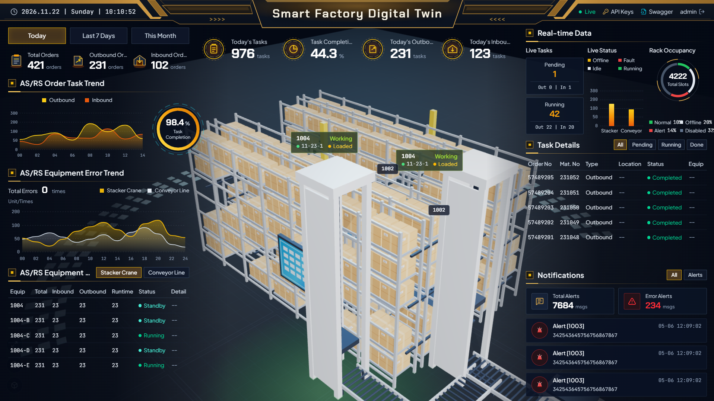

<div align="center">

# Smart Factory Digital Twin

**Real-Time 3D AS/RS Warehouse & Industrial Telemetry Platform**


</div>

---



## Overview

**Smart Factory Digital Twin** is a full-stack industrial monitoring and 3D visualization platform for Automated Storage and Retrieval Systems (AS/RS). It pairs a high-precision Three.js WebGL 3D warehouse twin with an authenticated PostgreSQL + Drizzle ORM backend, Socket.IO real-time telemetry streaming, strictly separated external ingest API authentication, and interactive Swagger OpenAPI documentation.

### Key Capabilities

- **Interactive 3D AS/RS Warehouse (Three.js)**: Multi-tier galvanized steel high-bay racks, instanced pallets & cardboard cargo, twin vertical lift towers, animated aisle stacker cranes driven by live database coordinates, roller conveyors, AGV shuttle, orbital floor grid, and projected 3D equipment callout tags (`1004`, `1002`).
- **Real-Time Telemetry Sync (Socket.IO)**: Sub-second WebSocket state synchronization from PostgreSQL to every connected operator browser—zero fake browser timers or backend random data loops.
- **Separated Authentication Boundaries**:
  - **Application Users**: `scrypt`-hashed credentials with HMAC-signed `Authorization: Bearer` tokens and authenticated Socket.IO handshakes.
  - **External Systems (WMS / ERP / PLC)**: Dedicated `/api/ingest/*` endpoints protected strictly via `X-API-Key` (SHA-256 hashed in PostgreSQL), rejecting user Bearer tokens (`403 Forbidden`).
- **Responsive Multi-Viewport HUD**: Full-bleed 3-column desktop command center (`1440px+`) that adapts cleanly into a stacked 3D + telemetry grid on tablets and mobile viewports.
- **Interactive Swagger Documentation**: Built-in OpenAPI 3.0.3 explorer at `/api/docs`.

---

## Project Structure

```text
.
├── docs/
│   └── dashboard-preview.png       # Reference preview embedded in README
├── scripts/
│   └── simulate-ingest.ts          # External HTTP ingest CLI simulator (X-API-Key)
├── server/
│   ├── auth.ts                     # Separated user Bearer JWT & X-API-Key middlewares
│   ├── dashboardService.ts         # Drizzle ORM queries & Zod-validated ingest handlers
│   └── swagger.ts                  # OpenAPI 3.0.3 specification builder
├── src/
│   ├── components/
│   │   ├── ApiKeysModal.tsx        # Generate, copy, and revoke X-API-Key credentials
│   │   ├── AuthGate.tsx            # Operator sign-in & registration screen
│   │   ├── Charts.tsx              # Order/Error spline charts, ring gauge, bar & donut charts
│   │   ├── Factory3DScene.tsx      # Three.js AS/RS 3D Digital Twin & tag projection
│   │   ├── FactoryIcons.tsx        # Industrial KPI & alert SVG emblems
│   │   ├── SectionHeader.tsx       # Gold-accented section dividers
│   │   └── TopHeader.tsx           # Stepped bronze-gold architectural header
│   ├── db/
│   │   ├── index.ts                # PostgreSQL pool (postgres-js) & schema bootstrap
│   │   └── schema.ts               # Drizzle pgTable schema definitions
│   ├── types/
│   │   └── dashboard.ts            # Shared TypeScript interfaces
│   ├── App.tsx                     # Main dashboard layout & Socket.IO client state
│   ├── index.css                   # Tailwind CSS v4 & typography utilities
│   └── main.tsx                    # React entry point
├── .env.example                    # Environment variable template (no secrets)
├── .gitignore                      # Git exclusion rules
├── drizzle.config.ts               # Drizzle Kit PostgreSQL configuration
├── index.html                      # HTML entry & Google Fonts (Chakra Petch / Plus Jakarta / JetBrains Mono)
├── package.json                    # Scripts & dependencies
├── server.ts                       # Express + Socket.IO + Vite/Static unified server
├── tsconfig.json                   # TypeScript configuration
└── vite.config.ts                  # Vite bundler configuration
```

---

## Application Architecture

```text
┌───────────────────────────┐         POST /api/ingest/*          ┌─────────────────────────────┐
│  External Systems         │  ───────  (X-API-Key)  ───────────▶ │  Express + Zod Validation   │
│  (WMS / ERP / PLC / CLI)  │                                     │  server.ts + auth.ts        │
└───────────────────────────┘                                     └──────────────┬──────────────┘
                                                                                 │ Drizzle ORM
                                                                                 ▼
┌───────────────────────────┐         Socket.IO (WSS)             ┌─────────────────────────────┐
│  Operator Browser         │ ◀────  dashboard:updated  ───────── │  PostgreSQL Database        │
│  React + Three.js Twin    │  ────  Bearer JWT Auth   ─────────▶ │  (users, api_keys, kpis,    │
│  (Port 3000)              │         REST /api/dashboard         │   trends, equipment, tasks) │
└───────────────────────────┘                                     └─────────────────────────────┘
```

### Authentication Separation

| Surface | Endpoints | Credential Type | Storage / Verification |
| --- | --- | --- | --- |
| **Operator App & WebSocket** | `/api/auth/*`, `/api/keys/*`, `/api/dashboard/*`, `/socket.io` | `Authorization: Bearer <token>` | `scrypt` salted password hash + HMAC-SHA256 token |
| **External System Ingest** | `/api/ingest/batch`, `/telemetry`, `/equipment`, `/tasks`, `/notifications` | `X-API-Key: sf_live_...` | SHA-256 key hash in `api_keys` (or `INGEST_API_KEY` env) |

---

## Tech Stack

- **Frontend**: React 19, TypeScript, Tailwind CSS v4, Three.js (`OrbitControls`, `RoomEnvironment`, `InstancedMesh`), Lucide Icons, Socket.IO Client
- **Backend**: Node.js, Express 4, Socket.IO 4, Zod, Swagger UI Express
- **Database & ORM**: PostgreSQL (Supabase Pooler compatible), Drizzle ORM, `postgres` driver, Drizzle Kit
- **Tooling**: Vite 8, `tsx`, TypeScript (`tsc`)

---

## Environment Variables

Copy `.env.example` to `.env` and fill in your PostgreSQL credentials:

```bash
cp .env.example .env
```

| Variable | Description | Example |
| --- | --- | --- |
| `DB_HOST` | PostgreSQL host | `aws-1-ap-northeast-2.pooler.supabase.com` |
| `DB_PORT` | PostgreSQL port | `5432` |
| `DB_NAME` | Database name | `postgres` |
| `DB_USER` | Database user | `postgres.yourproject` |
| `DB_PASSWORD` | Database password | `your-db-password` |
| `AUTH_TOKEN_SECRET` | Optional HMAC signing key for user sessions | `32+ char random secret` |
| `INGEST_API_KEY` | Optional static API key for external ingest | `sf_live_...` |

> Never commit `.env` to source control. `.gitignore` already excludes `.env*` while keeping `.env.example`.

---

## How to Build & Run

### 1. Install Dependencies

```bash
npm install
```

### 2. Push Database Schema to PostgreSQL

```bash
npm run db:push
```

### 3. Run in Development Mode

Starts Express, Socket.IO, Swagger UI, and Vite middleware together on port `3000`:

```bash
npm run dev
```

### 4. Type-Check & Build for Production

```bash
npm run lint
npm run build
npm start
```

### 5. Push Telemetry with the External Simulator

1. Open `http://localhost:3000` and register/sign in with an operator account.
2. Open **API Keys** in the top-right header and generate an `X-API-Key`.
3. Seed baseline factory telemetry or stream continuous updates from the CLI simulator:

```bash
# Seed initial baseline snapshot
INGEST_API_KEY="sf_live_your_key_here" npm run simulate -- --seed

# Stream continuous live updates (moves 3D cranes & updates KPIs in real time)
INGEST_API_KEY="sf_live_your_key_here" npm run simulate -- --loop
```

---

## API Documentation (Swagger)

Once the server is running, inspect and test all endpoints interactively at:

```text
http://localhost:3000/api/docs
```

Raw OpenAPI 3.0.3 JSON specification:

```text
http://localhost:3000/api/docs/openapi.json
```
